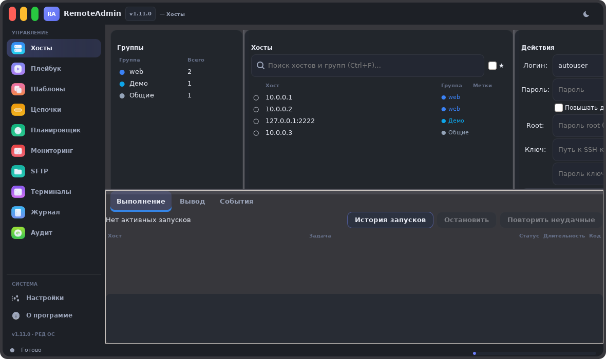
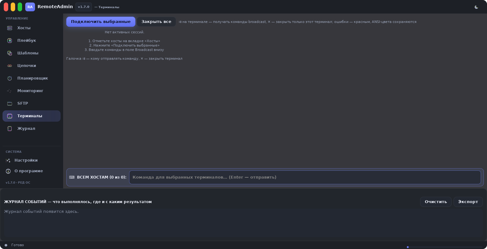

# RemoteAdmin

**Современный SSH-менеджер группы хостов на Go + GTK3.**
Массовое управление серверами: плейбуки, шаблоны задач, цепочки с откатом, мониторинг,
двухпанельный SFTP и мульти-терминал — в одном бескаркасном окне.

Пакеты собираются под **РЕД ОС 8** (RPM), а также Astra/Debian (DEB).


---

## Что внутри

| Раздел | Возможности |
|---|---|
| **Хосты** | Группы с цветовой маркировкой, поиск (Ctrl+F), метки, избранное, drag&drop, импорт Ansible inventory / Remmina / CSV / списка |
| **Действия** | Ping, «Инфо о системе», быстрая команда с историей, «Скрипт…» и «Заменить файл…» с предпросмотром и явным подтверждением |
| **Плейбук** | 8 типов задач (команда, скрипт, копирование, замена файла, правка sed, служба systemctl, пакеты dnf/yum); drag-and-drop задач; tooltip с полным текстом команды; подсветка bash; «Проверить синтаксис»; переменные `{{ var }}`; **менеджер секретов `{{ secret:имя }}`**; условие выполнения; политика ошибок; кнопка **«⏰ Запланировать»** |
| **Шаблоны** | Библиотека типовых операций: 9 готовых пресетов, создание из плейбука |
| **Цепочки** | Шаблоны выполняются по порядку: политика при успехе/ошибке, rollback-команды |
| **Планировщик** | Запуск задач по расписанию (cron-выражения, пресеты, расшифровка cron) |
| **Мониторинг** | CPU/RAM/диски/load с точным подсчётом по дельтам, алерты, график за период |
| **SFTP** | Двухпанельный менеджер, F3–F8/Del как в коммандерах, правка файлов с бэкапом, вход под root |
| **Терминалы** | ClusterSSH-сетка: broadcast-ввод, выбор получателей галочкой «⇉», закрытие каждой сессии «✕», полноценный ANSI-цвет |
| **Журнал** | **Цветовое кодирование**: зелёный — успех, красный — ошибка, жёлтый — предупреждение; **двойной щелчок по записи — полный вывод команды (stdout/stderr) на этом хосте**; ANSI-цвета сохраняются; экспорт HTML / CSV / PDF |

## Структура проекта

```
RemoteAdmin/
├── cmd/remoteadmin/     # исходный код приложения (package main)
│   ├── main.go          # точка входа, флаги --selftest / --autotest
│   ├── ui.go            # каркас окна, боковая навигация
│   ├── hosts.go         # вкладка «Хосты»: группы, импорт, действия
│   ├── playbook.go      # редактор плейбуков: задачи, DnD, запуск
│   ├── pbxtras.go       # подсветка bash, проверка синтаксиса, переменные
│   ├── secrets.go       # менеджер секретов {{ secret:имя }}
│   ├── chains.go        # цепочки шаблонов с rollback
│   ├── scheduler.go     # cron-парсер и тик планировщика
│   ├── schedui.go       # вкладка «Планировщик»
│   ├── monitor.go       # мониторинг CPU/RAM/диски + графики
│   ├── sftp*.go         # двухпанельный SFTP-менеджер
│   ├── multiterm.go     # мульти-терминал (ClusterSSH)
│   ├── reports.go       # журнал + экспорт HTML/CSV
│   ├── pdfexport.go     # экспорт PDF (кириллица)
│   ├── logarea.go       # журнал событий, развёртка вывода
│   ├── state.go         # модель данных и хранилище state.json
│   ├── crypto.go        # AES-256-GCM шифрование паролей
│   ├── masterpass.go    # шифрование хранилища мастер-паролем
│   └── …                # ansi.go, theme.go, icons.go, autotest.go
├── assets/              # иконка приложения
├── docs/screenshots/    # скриншоты вкладок
├── packaging/rpm/       # SPEC для РЕД ОС 8
├── scripts/             # build.sh (RPM/deb/AppImage), genicon.go
├── vendor/              # зафиксированные зависимости (gotk3 и др.)
├── Makefile             # make build / test / selftest / packages
└── .github/workflows/   # CI: сборка и тесты
```

## Скриншоты

| Хосты | Терминалы |
|---|---|
|  |  |

Остальные вкладки — в [docs/screenshots](docs/screenshots).

## Установка

### РЕД ОС 8 / RPM
```bash
sudo dnf install ./remoteadmin-1.8.0-1.x86_64.rpm
```
Зависимости: `gtk3 >= 3.24`, `openssh-clients` (рекомендуется `libnotify`).

### Astra Linux / Debian / DEB
```bash
sudo apt install ./remoteadmin_1.8.0_amd64.deb
```

## Сборка из исходников

```bash
git clone https://github.com/flytimopheev-sketch/RemoteAdmin.git
cd RemoteAdmin
make build          # бинарник (нужен Go >= 1.23, pkg-config, libgtk-3-dev)
make test           # юнит-тесты
make packages       # RPM + DEB + AppImage + source tar.gz (нужен rpmbuild)
```

Быстрая проверка интерфейса без дисплея:
```bash
./remoteadmin --selftest   # SELFTEST OK
./remoteadmin --autotest   # 48 проверок состояния, SSH, SFTP и вкладок
```

## Журнал: цвета и развёртка вывода (v1.8.0)

- **Цветовое кодирование по результату**: зелёные строки — успешные операции,
  красные — ошибки, жёлтые — предупреждения (и в ленте событий, и в дереве журнала).
- **Двойной щелчок** по строке хоста в ленте или по записи журнала открывает
  «развёрнутую» запись: полный stdout/stderr команды на этом хосте с цветной
  разметкой и кнопкой «Копировать».
- Каждый запуск задачи на каждом хосте попадает в журнал отдельной записью —
  видно, как `df -h` отработала на каждом сервере, а не только факт запуска.

## Секреты и пароли (v1.8.0)

- **Менеджер секретов** (кнопка «🔐 Секреты…» во вкладке «Плейбук»): имена и
  значения хранятся в `state.json` **в зашифрованном виде** (AES-256-GCM, ключ
  машины `~/.config/RemoteAdmin/secret.key` с правами 0600).
- В командах и скриптах секрет подставляется по ссылке **`{{ secret:имя }}`**
  только в момент выполнения. Сам плейбук хранит только ссылку, не значение.
- **В журнал секреты не попадают**: вывод команд маскируется — любое значение
  секрета, а также SSH- и root-пароль заменяются на «••••••».
- Пароль root (для повышения через `su`) и SSH-пароль хранятся только
  зашифрованными; опционально весь `state.json` шифруется **мастер-паролем**
  (scrypt + AES-256-GCM) — раздел «Безопасность» в настройках.
- Ошибка повышения до root (неверный пароль, ненулевой код выхода) честно
  помечает задачу как FAIL и останавливает плейбук при включённом
  «Прервать при ошибке».

## Планирование запуска (v1.8.0)

Кнопка **«⏰ Запланировать»** рядом с «▶ Запустить playbook»: текущий плейбук
сохраняется как шаблон (если ещё не сохранён) и открывается диалог расписания
с уже выбранным шаблоном — задайте cron (есть пресеты «каждые 15 мин»,
«ежедневно 03:30», «по будням 09:00») и группу хостов. Готово — без перехода
на вкладку «Планировщик».

## Горячие клавиши

| Клавиши | Действие |
|---|---|
| `Ctrl+F` | Поиск хостов |
| `Ctrl+1…9` | Переход между вкладками |
| `Enter` (поле broadcast) | Команда во все терминалы с галочкой «⇉» |
| `Delete` (в списке) | Удалить выбранные хосты/шаблоны/задачу |
| Двойной клик по хосту | Редактирование имени/адреса/группы |
| Двойной клик по записи журнала | Полный вывод команды на хосте |

## Безопасность

- Пароли и секреты шифруются **AES-256-GCM** (ключ привязан к машине);
  по желанию весь `state.json` шифруется **мастер-паролем** (scrypt).
- Секреты маскируются во всех журналах и экспортах (HTML/CSV/PDF).
- Ключи хостов проверяются как в `ssh known_hosts`, детект смены ключа.
- Опасные операции (замена файлов, sed, rollback) требуют подтверждения;
  кнопка «Скрипт…» показывает содержимое скрипта и список хостов ДО запуска;
  «🗑 Очистить всё» в плейбуке убрана от кнопки запуска и спрашивает подтверждение.
- Восстановление сессии хранит только геометрию окна, вкладку и выбор хостов.

## Лицензия

MIT — см. [LICENSE](LICENSE).
